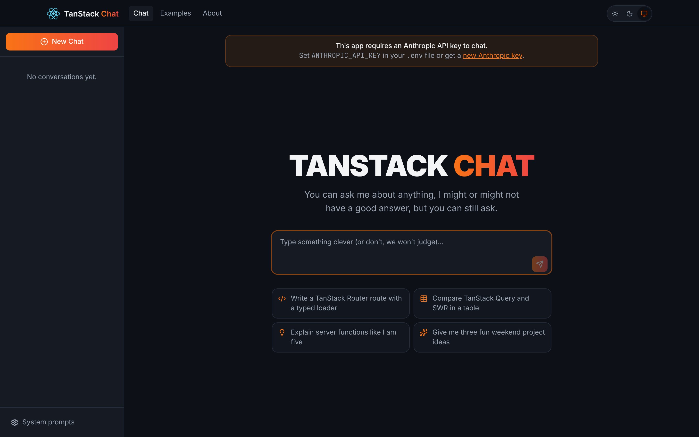
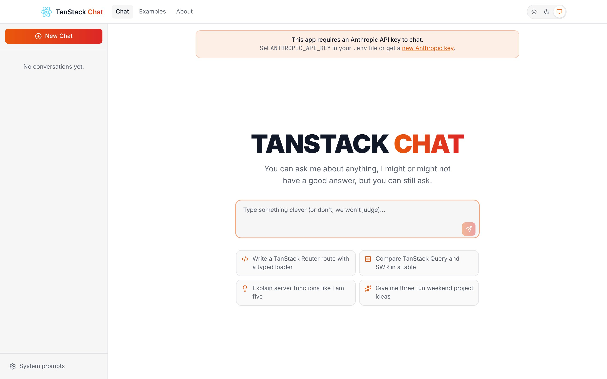
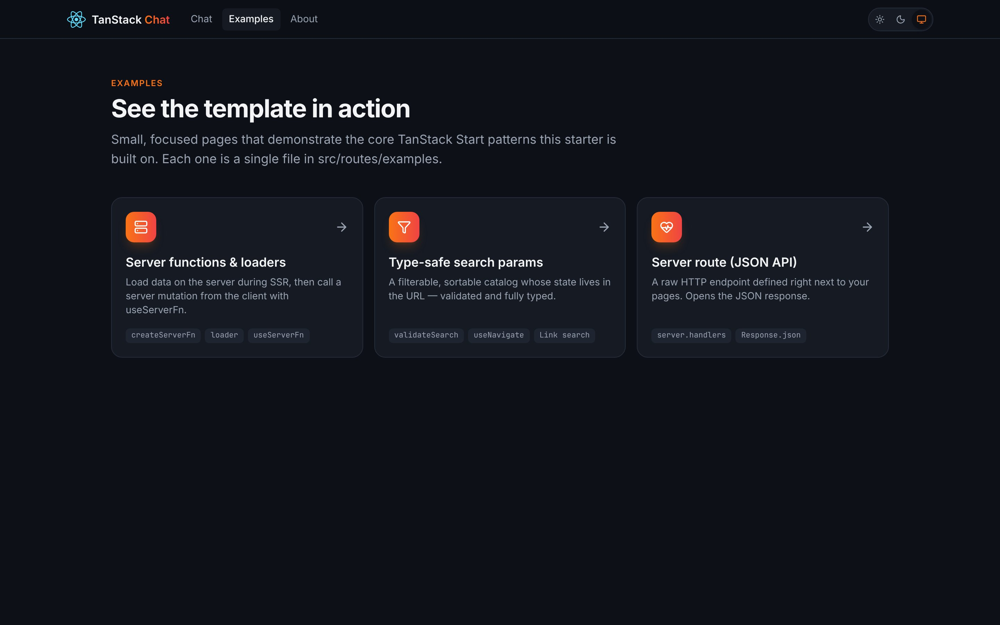
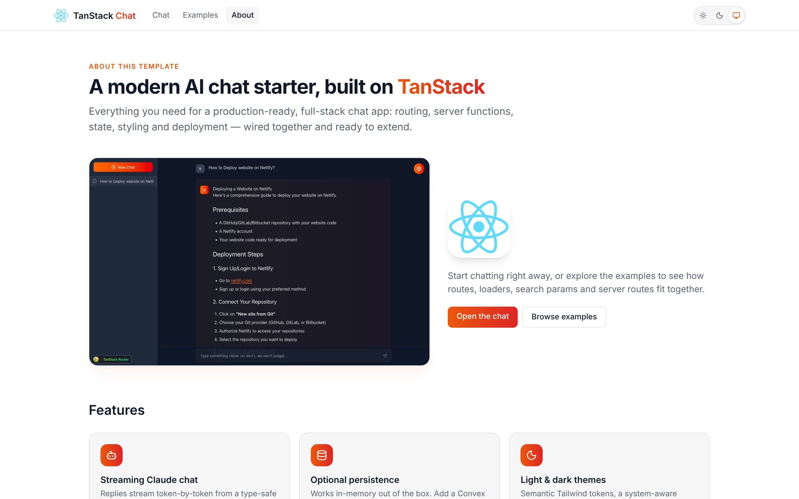
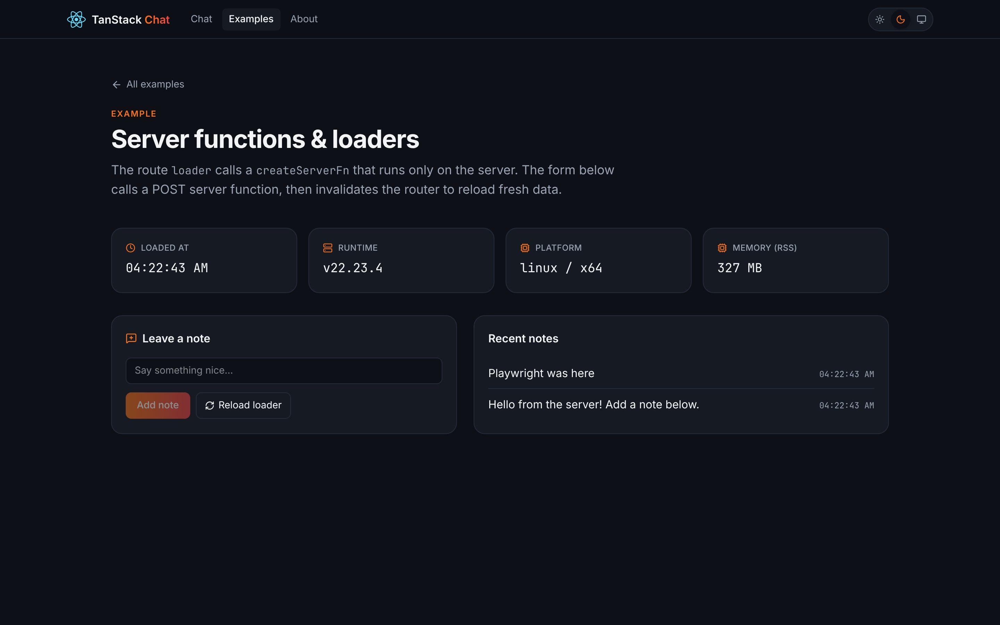
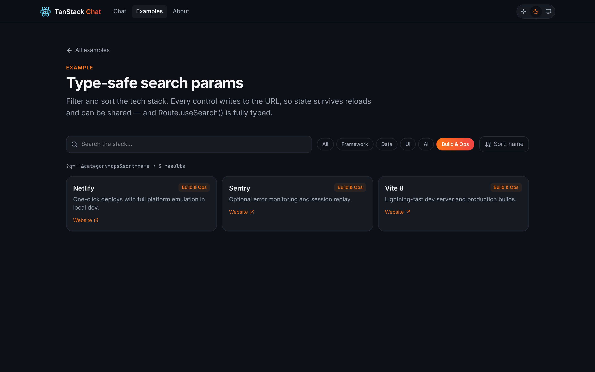
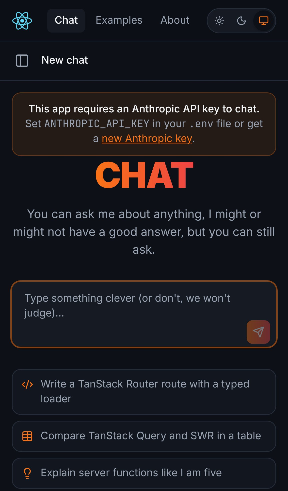
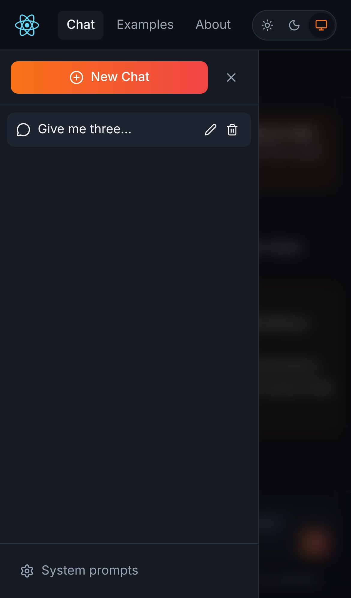

# TanStack Chat Template


A modern, full-stack AI chat template built with **TanStack Start**, **TanStack Router** and **TanStack Store**, with Claude streaming replies through a type-safe server function. It has light and dark themes, a responsive layout, and a set of example pages showing the core TanStack Start patterns.

**⚡ View demo:** [https://tanstack-starter.netlify.app/](https://tanstack-starter.netlify.app/)

## Table of Contents
- [Deploy to Netlify](#deploy-to-netlify)
- [Screenshots](#screenshots)
- [Features](#features)
- [Tech Stack](#tech-stack)
- [Getting Started](#getting-started)
- [Scripts](#scripts)
- [Environment Configuration](#environment-configuration)
- [Project Structure](#project-structure)
- [Example Pages](#example-pages)
- [Routing](#routing)
- [Data Fetching & Server Functions](#data-fetching--server-functions)
- [State Management](#state-management)
- [Styling & Theming](#styling--theming)
- [Error Monitoring](#error-monitoring)
- [Upgrading from the 2025 version](#upgrading-from-the-2025-version)
- [Troubleshooting](#troubleshooting)
- [Learn More](#learn-more)

## Deploy to Netlify

Want to deploy immediately? Click this button

[](https://app.netlify.com/start/deploy?repository=https://github.com/netlify-templates/tanstack-template)

Clicking this button will create a new repo for you that looks exactly like this one, and sets that repo up immediately for deployment on Netlify. You will be asked for an `ANTHROPIC_API_KEY`.

## Screenshots

| Dark | Light |
| --- | --- |
|  |  |
|  |  |
|  |  |

<p align="center">
  
  &nbsp;&nbsp;
  
</p>

## Features

### AI
- 🤖 Streaming replies from Claude (`claude-opus-5-5` by default, configurable with `ANTHROPIC_MODEL`)
- 🔐 The API key stays on the server and is never sent to the browser
- 🎯 Custom system prompts you can switch on and off
- 📝 Markdown rendering with syntax highlighting, sanitized with `rehype-sanitize`

### User experience
- 🌗 Light, dark and system themes, with no flash of the wrong theme on load
- 📱 Responsive layout with a slide-out conversation drawer on phones
- 💡 Suggested prompts on the welcome screen
- ✏️ Rename and delete conversations; optional Convex persistence
- ♿ Labelled controls, keyboard support (Enter to send, Shift+Enter for a new line, Esc to close dialogs) and reduced-motion support

### Template showcase
- 🧪 Example pages for loaders, server functions, type-safe search params and server routes
- 🩺 A `/api/health` JSON endpoint

## Tech Stack

| Area | Tools |
| --- | --- |
| Framework | React 19, TanStack Start (Vite plugin), TanStack Router |
| State | TanStack Store |
| Database | Convex (optional) |
| Styling | Tailwind CSS 4 + `@tailwindcss/typography`, Lucide icons |
| AI | Anthropic TypeScript SDK |
| Build & deploy | Vite 8, `@netlify/vite-plugin-tanstack-start` |
| Quality | TypeScript (strict), ESLint (`@tanstack/eslint-config`) |
| Monitoring | Sentry (optional) |

## Getting Started

### Prerequisites

- [Node.js](https://nodejs.org/) v20.19+ or v22.12+ (v22 LTS recommended)
- An [Anthropic API key](https://console.anthropic.com/settings/keys)
- (optional) a [Convex account](https://dashboard.convex.dev/signup) for persistent storage

### Local setup

```bash
git clone https://github.com/netlify-templates/tanstack-template.git
cd tanstack-template
npm install
cp .env.example .env   # then add your ANTHROPIC_API_KEY
npm run dev
```

The app runs at [http://localhost:3000](http://localhost:3000).

## Scripts

| Command | What it does |
| --- | --- |
| `npm run dev` | Start the dev server (with Netlify platform emulation) on port 3000 |
| `npm run build` | Build the client and server for production (output in `dist/`, Netlify function in `.netlify/`) |
| `npm start` / `npm run preview` | Serve the production build locally |
| `npm run typecheck` | Type-check the project with `tsc` |
| `npm run lint` | Lint with ESLint |
| `npm run check` | Type-check, then lint |

## Environment Configuration

Create a `.env` file in the project root (see `.env.example`):

```bash
# Required for chat (server-only)
ANTHROPIC_API_KEY=your_anthropic_api_key
# Optional: use a different Claude model
# ANTHROPIC_MODEL=claude-opus-5-5

# Optional: persist conversations in Convex
VITE_CONVEX_URL=your_convex_deployment_url

# Optional: Sentry
VITE_SENTRY_DSN=your_sentry_dsn
SENTRY_AUTH_TOKEN=your_sentry_auth_token
SENTRY_ORG=your_sentry_org
SENTRY_PROJECT=your_sentry_project
```

### Anthropic API key

Chat needs `ANTHROPIC_API_KEY`. It is read only inside server functions. The old `VITE_ANTHROPIC_API_KEY` name still works as a fallback, but it is deprecated. Vite inlines any `VITE_*` variable that client code reads into the JavaScript bundle, so use `ANTHROPIC_API_KEY` for secrets.

### Convex (optional)

Without Convex, conversations live in memory and reset on reload. To persist them:

1. Create a Convex account at [dashboard.convex.dev](https://dashboard.convex.dev/signup)
2. Run `npx convex dev` in the project directory to create and link a deployment
3. Add the deployment URL to `.env` as `VITE_CONVEX_URL`

The schema and functions live in [`convex/`](convex).

## Project Structure

```
├── convex/                  # Convex schema + queries/mutations (optional)
├── docs/screenshots/        # README screenshots
├── public/                  # Static assets (logos, favicon, manifest, images)
├── src/
│   ├── client.tsx           # Client entry (hydration + Sentry init)
│   ├── router.tsx           # getRouter() factory
│   ├── routeTree.gen.ts     # Generated by TanStack Router (do not edit)
│   ├── styles.css           # Tailwind 4 config, theme tokens, markdown styles
│   ├── components/          # Chat UI, header, theme toggle, page shell
│   ├── lib/                 # Theme store/script, shared data
│   ├── routes/
│   │   ├── __root.tsx       # HTML document, header, providers
│   │   ├── index.tsx        # Chat
│   │   ├── about.tsx        # About / features / tech stack
│   │   ├── examples/        # Example pages
│   │   └── api/health.ts    # JSON server route
│   ├── store/               # TanStack Store state + Convex-aware hooks
│   └── utils/ai.ts          # Claude server functions
├── eslint.config.js
├── netlify.toml
└── vite.config.ts
```

## Example Pages

| Route | Shows |
| --- | --- |
| `/examples` | Index of the examples |
| `/examples/server-functions` | `loader` + GET server function during SSR; POST server function via `useServerFn`, then `router.invalidate()` |
| `/examples/search-params` | `validateSearch`, `stripSearchParams`, `useNavigate` and `<Link search>`: filter state kept in the URL |
| `/api/health` | A server route (`server.handlers.GET`) returning JSON |
| `/about` | Feature overview built from the template's own assets |

## Routing

This project uses [TanStack Router](https://tanstack.com/router) with file-based routing. Each file in `src/routes` becomes a route, and `src/routeTree.gen.ts` is regenerated automatically by the Vite plugin.

### Adding a route

Create a file such as `src/routes/hello.tsx`:

```tsx
import { createFileRoute } from '@tanstack/react-router'

export const Route = createFileRoute('/hello')({
  component: () => <main className="p-8">Hello!</main>,
})
```

### Adding links

```tsx
import { Link } from '@tanstack/react-router'

<Link to="/about">About</Link>
```

Links are fully typed: a typo in `to` is a type error. See the [Link documentation](https://tanstack.com/router/latest/docs/framework/react/api/router/linkComponent).

### Layout

`src/routes/__root.tsx` holds the HTML document and the site header. Child routes render where `<Outlet />` is placed.

## Data Fetching & Server Functions

Server-only code goes in `createServerFn`. Call it from a route `loader` to fetch data during SSR and client navigation:

```tsx
import { createFileRoute } from '@tanstack/react-router'
import { createServerFn } from '@tanstack/react-start'

const getTime = createServerFn({ method: 'GET' }).handler(() => new Date().toISOString())

export const Route = createFileRoute('/time')({
  loader: () => getTime(),
  component: () => <p>{Route.useLoaderData()}</p>,
})
```

For a raw HTTP endpoint, add a `server.handlers` object to a route (see `src/routes/api/health.ts`). The chat itself uses a POST server function (`genAIResponse` in `src/utils/ai.ts`) that returns a streaming `Response` of text chunks.

## State Management

App state (conversations, system prompts, loading state, theme) lives in [TanStack Store](https://tanstack.com/store):

```tsx
import { Store, useStore } from '@tanstack/react-store'

export const counter = new Store({ count: 0 })

function Counter() {
  const count = useStore(counter, (s) => s.count)
  return (
    <button onClick={() => counter.setState((s) => ({ count: s.count + 1 }))}>
      {count}
    </button>
  )
}
```

`src/store/hooks.ts` chooses at build time between an in-memory implementation and a Convex-backed one, depending on whether `VITE_CONVEX_URL` is set.

## Styling & Theming

Tailwind CSS 4 is configured in `src/styles.css`; there is no `tailwind.config.js`. Colors are semantic tokens (`bg-surface`, `bg-surface-2`, `text-fg`, `text-muted`, `border-line`, `text-accent`, plus the `bg-brand` and `text-brand` gradients). Their dark values are set under `.dark`, so components need no `dark:` variants for basic colors.

The theme toggle (`src/components/ThemeToggle.tsx`) stores the choice in `localStorage`. A small inline script in `<head>` applies it before first paint.

## Error Monitoring

[Sentry](https://sentry.io) is optional. Set `VITE_SENTRY_DSN` to enable browser error reporting and session replay. Set `SENTRY_AUTH_TOKEN`, `SENTRY_ORG` and `SENTRY_PROJECT` to upload source maps at build time.

## Upgrading from the 2025 version

This template moved from the Vinxi-based TanStack Start beta to the current Vite plugin:

- `app.config.ts`, `postcss.config.ts`, `src/ssr.tsx` and `src/api.ts` were removed. Configuration now lives in `vite.config.ts`.
- `src/router.tsx` exports `getRouter()`, and server routes use `createFileRoute(...)({ server: { handlers } })`.
- Rename `VITE_ANTHROPIC_API_KEY` to `ANTHROPIC_API_KEY` in `.env` and in your Netlify site settings.
- `npm run serve` became `npm run preview`.

## Troubleshooting

- **API key errors**: check that `ANTHROPIC_API_KEY` is set (`/api/health` reports `chatConfigured`) and that your Anthropic account has credits.
- **Port conflicts**: if port 3000 is taken, Vite picks the next free port. Check the terminal output for the URL.
- **Node version**: Vite 8 needs Node 20.19+ or 22.12+. Check with `node -v`.
- **Convex**: run `npx convex dev` alongside `npm run dev`.

## Learn More

- [TanStack Start](https://tanstack.com/start)
- [TanStack Router](https://tanstack.com/router)
- [TanStack Store](https://tanstack.com/store)
- [Claude API documentation](https://platform.claude.com/docs)
- [Convex](https://docs.convex.dev)
- [Netlify + TanStack Start](https://docs.netlify.com/build/frameworks/framework-setup-guides/tanstack-start/)
